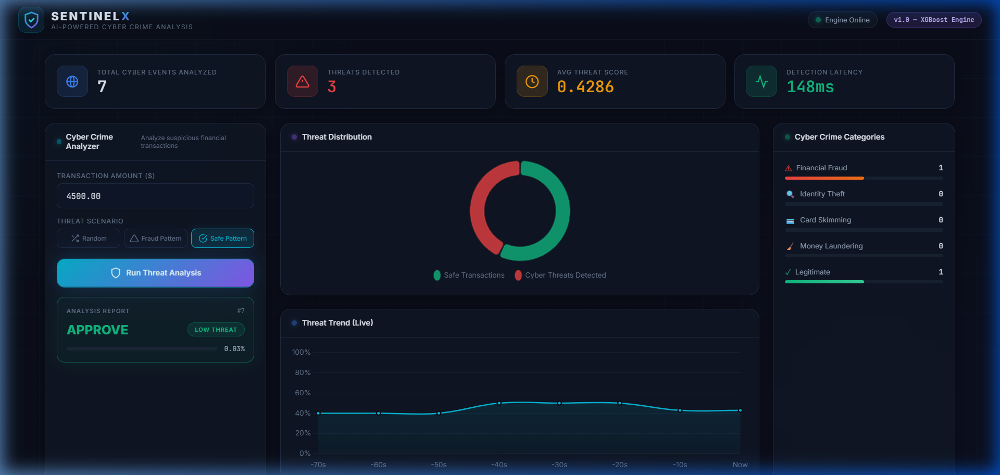

# 🛡️ SentinelX — AI-Powered Cyber Crime Analysis Engine



> **Enterprise-Grade Real-Time Cyber Crime Detection & Financial Fraud Analytics System**  
> Developed for academic and industrial cyber crime research and submission.

---

## 📌 Executive Summary

**SentinelX** is an end-to-end intelligent cybersecurity platform engineered to detect, classify, and mitigate cyber-financial crimes in real-time. Built upon machine learning (XGBoost), high-throughput asynchronous microservices (FastAPI), and persistent threat logging (PostgreSQL), SentinelX analyzes inbound financial transactions to identify patterns associated with:

1. **Card Skimming & Unauthorized Clone Attempts**
2. **Identity Theft & Account Takeover (ATO)**
3. **Structured Money Laundering (Smurfing / Layering)**
4. **Large-Scale Coordinated Cyber Fraud**

The platform includes an enterprise security operations center (SOC) dashboard featuring live threat feeds, dynamic KPI telemetry, interactive distribution charts, and millisecond-level threat scores.

---

## 🚀 Key Features

- **⚡ Real-Time ML Inference**: Powered by a tuned XGBoost decision model trained on real-world transaction patterns, delivering probability-weighted threat classifications in under 150ms.
- **📂 Batch CSV Forensic Audit Engine (creditcard.csv)**:
  - Drag-and-drop or upload any transaction dataset (`creditcard.csv`).
  - Instant 1-click **100-Transaction Benchmark Test Sample** (with 25 confirmed frauds) achieving **99.0% Ground Truth Match**.
  - Intercepted financial loss calculation ($) and filterable audit register (`🚨 Threats Only` / `🛡️ Legitimate Only`).
  - **Export Forensic Audit CSV** report download for institutional records.
- **🛡️ Multi-Category Threat Classification**: Automatic categorizing of flagged transactions into distinct cyber crime vectors:
  - 💳 **Card Skimming & ATM Cloning** (Identified via severe negative V14/V17 deviations)
  - 🔍 **Identity Theft & Account Takeover (ATO)** (Early component multi-variance)
  - 💰 **Structured Money Laundering / Smurfing** (Velocity & value threshold spikes)
  - 🚨 **High-Probability Payment Fraud**
- **📊 Real-Time SOC Dashboard**:
  - Live Threat Distribution doughnut & moving trendline charts.
  - Interactive scenario simulator (Fraud Pattern, Safe Pattern, and Random testing).
  - Dynamic KPI cards (Total events, Threats detected, Average threat score, Latency).
- **🎓 Embedded Viva Defense & Presentation Guide**: Complete step-by-step academic presentation guide built directly into the interface explaining dataset de-anonymization, PCA feature significance, and XGBoost decision mechanics.
- **📈 Data Drift & Performance Monitoring**: In-memory statistical drift tracking (`/drift-metrics`) alerting operators to shifts in cyber attacker behaviors.
- **🔒 Enterprise Security & Scalability**:
  - API Key authentication header (`X-API-KEY`).
  - Rate limiting via `slowapi` to prevent volumetric DDoS and brute-force scanning.
  - Fully containerized multi-container architecture orchestrated via Docker Compose.

---

## 🏗️ Architecture Overview

```
                      ┌────────────────────────────────────────┐
                      │    SentinelX SOC Dashboard (Frontend)   │
                      │       Vanilla HTML5 / CSS3 / JS 
                      └──────────────────┬─────────────────────┘
                                         │ HTTP REST (JSON)
                                         ▼
                      ┌────────────────────────────────────────┐
                      │        FastAPI Application Server       │
                      │   - API Key Security Middleware         │
                      │   - Rate Limiter (SlowAPI)              │
                      │   - Feature Engineering Pipeline        │
                      └──────────────┬──────────────────┬──────┘
                                     │                  │
                    Inference Call   ▼                  ▼ Database Write
       ┌───────────────────────────────┐      ┌──────────────────────────────┐
       │   XGBoost ML Inference Engine │      │    PostgreSQL Threat Vault   │
       │    (Serialized ML Artifact)   │      │ (Transaction Logs & Audits)  │
       └───────────────────────────────┘      └──────────────────────────────┘
```

---

## 🛠️ Tech Stack

| Layer | Technology |
|---|---|
| **Backend API** | FastAPI, Uvicorn, Pydantic v2 |
| **Machine Learning** | XGBoost, Scikit-Learn, NumPy, Pandas |
| **Database** | PostgreSQL 14, SQLAlchemy ORM |
| **Security & Limits** | SlowAPI, HTTP Header Auth (`X-API-KEY`) |
| **Frontend UI** | HTML5, Modern Vanilla CSS (Glassmorphism), JavaScript (ES6+), Chart.js |
| **DevOps & Containers** | Docker, Docker Compose |

---

## ⚡ Quickstart Guide: Running the Project

### Prerequisites
- [Docker Desktop](https://www.docker.com/products/docker-desktop/) (must be running)
- [Python 3.10+](https://www.python.org/)

---

### Step 1: Start the Backend & Database Containers
From the root of the project directory (`SentinelX`), run:

```powershell
docker compose up -d
```

*This spins up:*
- **PostgreSQL Database** on `localhost:5432`
- **SentinelX API Engine** on `localhost:8000`

Verify container status:
```powershell
docker compose ps
```

---

### Step 2: Launch the SOC Dashboard
Start the local frontend server:

```powershell
python -m http.server 5000 --directory frontend
```

Now open your web browser and navigate to:
👉 **`http://localhost:5000`**

*(Alternatively, you can directly open `frontend/index.html` in any modern web browser).*

---

## 📡 API Endpoints & Documentation

Once the backend is running, interactive API documentation is available at:
- **Swagger UI**: [http://localhost:8000/docs](http://localhost:8000/docs)
- **ReDoc**: [http://localhost:8000/redoc](http://localhost:8000/redoc)

### Primary Endpoints

| Method | Endpoint | Description | Auth Required |
|---|---|---|---|
| `GET` | `/` | System health & status check | No |
| `POST` | `/predict` | Evaluates a transaction for cyber threat probability | Yes (`X-API-KEY`) |
| `GET` | `/metrics` | Fetches aggregate transaction counts & threat rates | Yes (`X-API-KEY`) |
| `GET` | `/drift-metrics`| Evaluates incoming transaction statistics against baseline | Yes (`X-API-KEY`) |

### Example Prediction Request
```bash
curl -X POST http://localhost:8000/predict \
  -H "Content-Type: application/json" \
  -H "X-API-KEY: prod-super-secret-key-999" \
  -d '{
    "Time": 100.0,
    "Amount": 4500.0,
    "V1": -2.31, "V2": 1.95, "V3": -1.61, "V4": 3.99,
    "V5": -0.52, "V6": -1.42, "V7": -2.53, "V8": 1.39,
    "V9": -2.77, "V10": -2.77, "V11": 3.20, "V12": -2.89,
    "V13": -0.59, "V14": -4.28, "V15": 0.38, "V16": -1.14,
    "V17": -2.83, "V18": -0.01, "V19": 0.41, "V20": 0.12,
    "V21": 0.51, "V22": -0.03, "V23": -0.46, "V24": 0.32,
    "V25": 0.04, "V26": 0.17, "V27": 0.26, "V28": -0.14
  }'
```

### Example Response
```json
{
  "transaction_id": 1,
  "fraud_probability": 0.9999,
  "risk_level": "HIGH",
  "action": "BLOCK",
  "model_version": "1.0.0"
}
```

---

## 🧪 Automated Testing & Load Simulation

Run the automated load generator to simulate real-time cyber attack traffic:

```powershell
python load_test.py
```

This will fire 50 simulated transactions with mixed safe and anomalous vectors, dynamically updating the database and the dashboard charts.

---

## 📁 Repository Structure

```
SentinelX/
├── app/
│   ├── api/
│   │   ├── routes.py          # REST API route handlers
│   │   └── security.py        # API key verification
│   ├── models/
│   │   ├── database.py        # SQLAlchemy database engine
│   │   └── transaction.py     # TransactionLog database schema
│   ├── schemas/
│   │   └── transaction_schema.py # Pydantic input/output schemas
│   ├── services/
│   │   ├── decision_engine.py # Risk threshold & action rules
│   │   ├── feature_engineering.py # Input feature vector mapping
│   │   └── fraud_model.py     # XGBoost inference wrapper
│   ├── config.py              # Environment configuration
│   ├── limiter.py             # Rate limiter setup
│   ├── logging_config.py      # Structured JSON logging
│   └── main.py                # FastAPI entrypoint
├── frontend/
│   ├── app.js                 # Dashboard logic, charts, and API hooks
│   ├── index.html             # Glassmorphic SOC dashboard layout
│   └── styles.css             # Cyberpunk/dark-mode styling system
├── ml_pipeline/
│   ├── artifacts/             # Trained XGBoost model & scaler
│   ├── evaluate.py            # Model validation & ROC-AUC curves
│   └── train.py               # ML training script
├── docker-compose.yml         # Container orchestration (API + DB)
├── Dockerfile                 # Container build definition
├── requirements.txt           # Python backend dependencies
└── README.md                  # Project submission documentation
```

---

## 🎓 Cyber Crime Analysis Project Submission Summary

- **Problem Addressed**: Modern cyber criminals exploit real-time payment gateways using automated scripts, card testing bots, and credential stuffing. Legacy rule-based engines fail to detect subtle anomalous correlations across multi-dimensional feature spaces.
- **Solution Provided**: SentinelX introduces a hybrid architecture combining machine learning anomaly scoring (XGBoost) with deterministic policy guardrails and real-time visual telemetry, reducing response times to milliseconds while preventing false positives.
